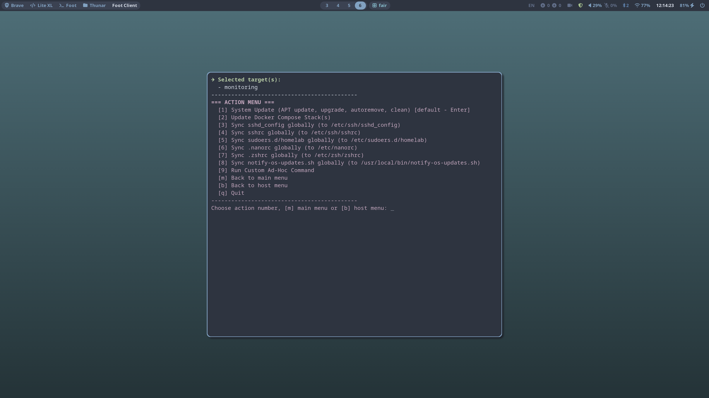
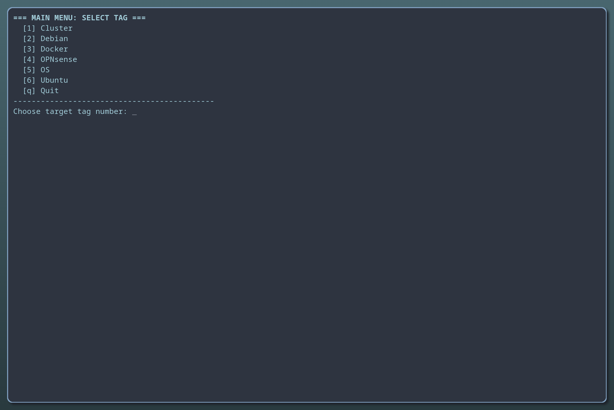
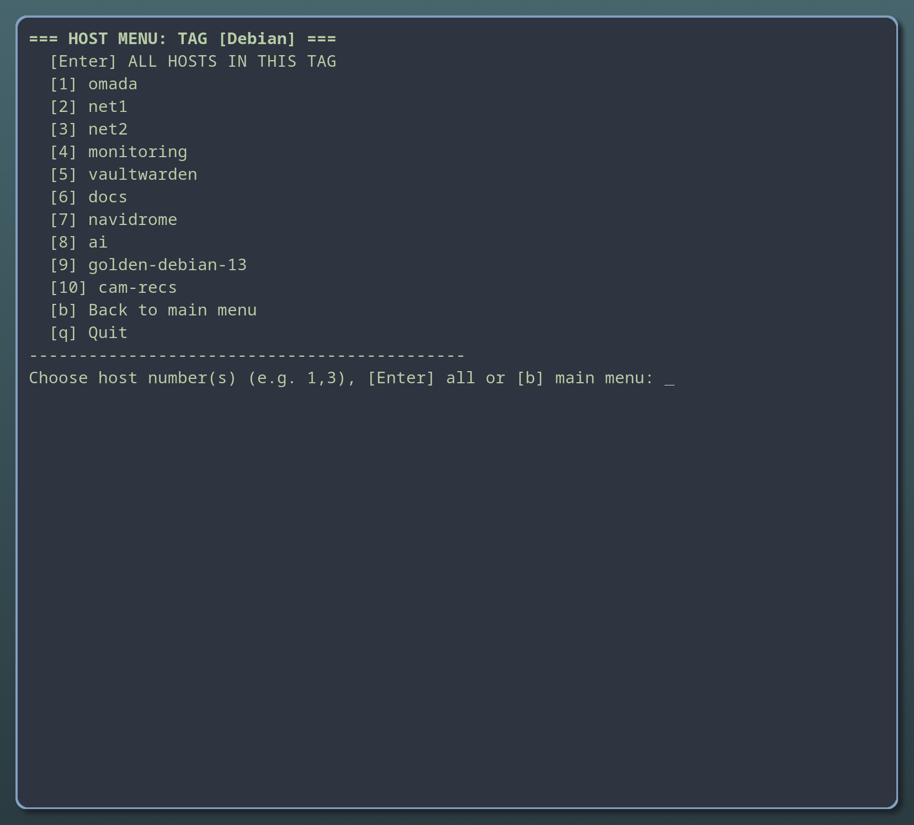
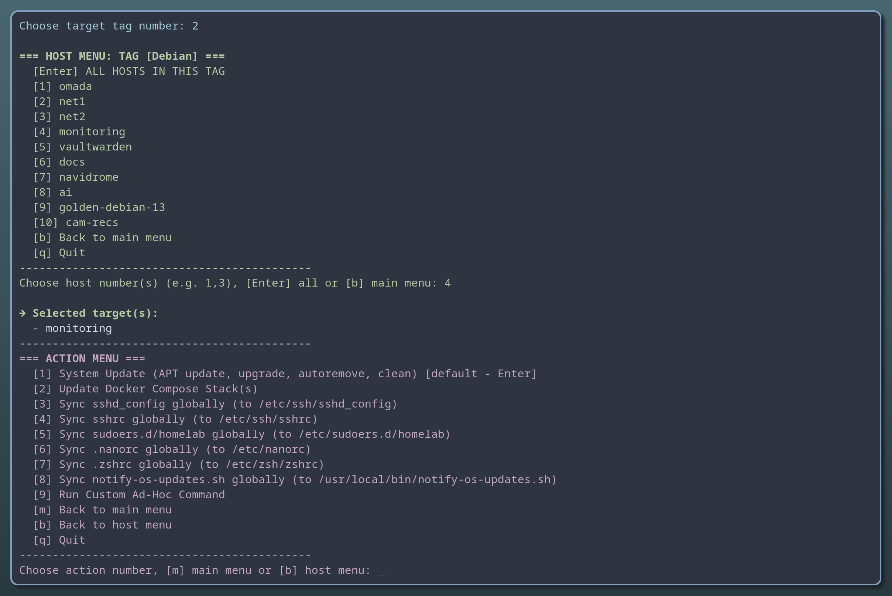
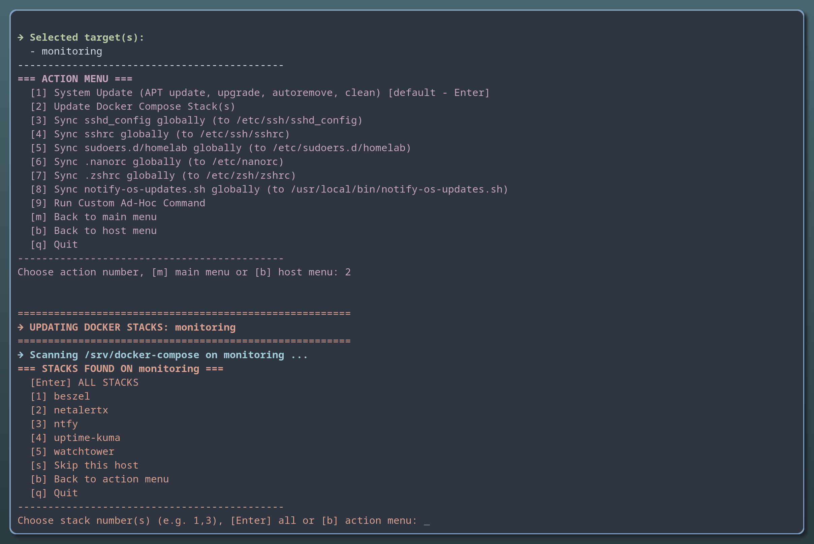
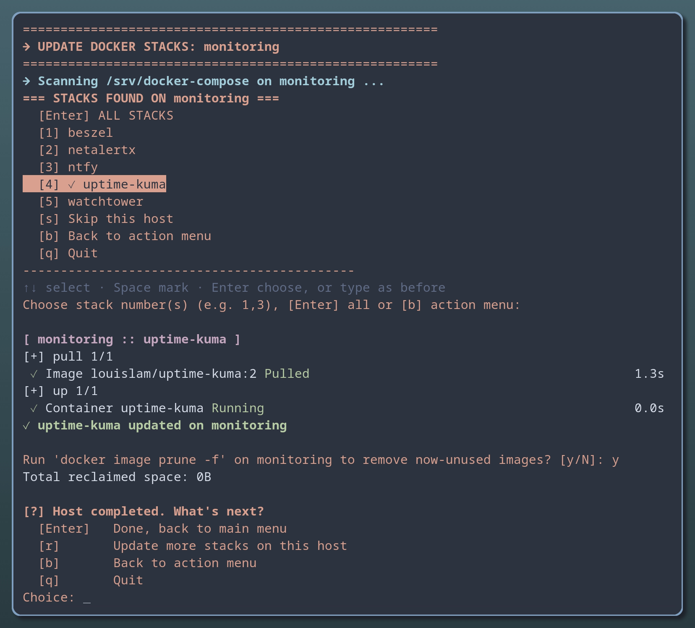
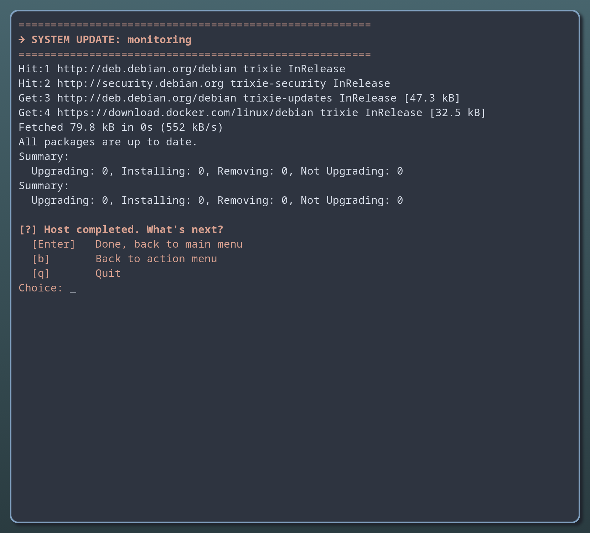
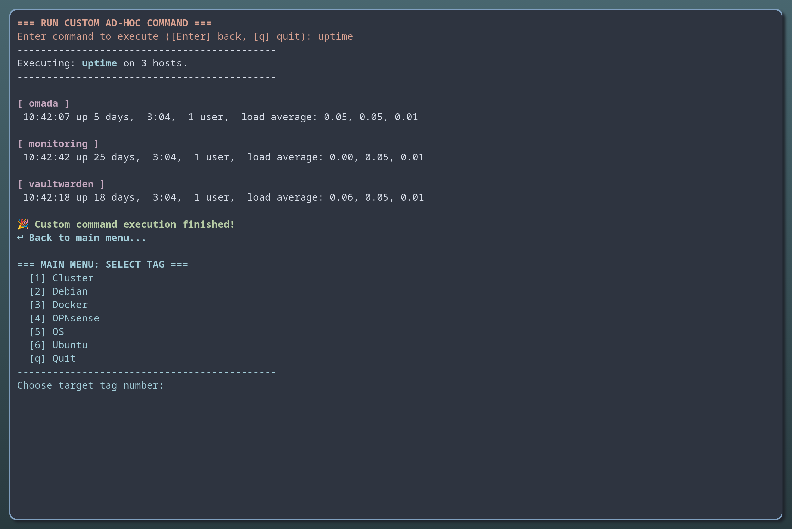
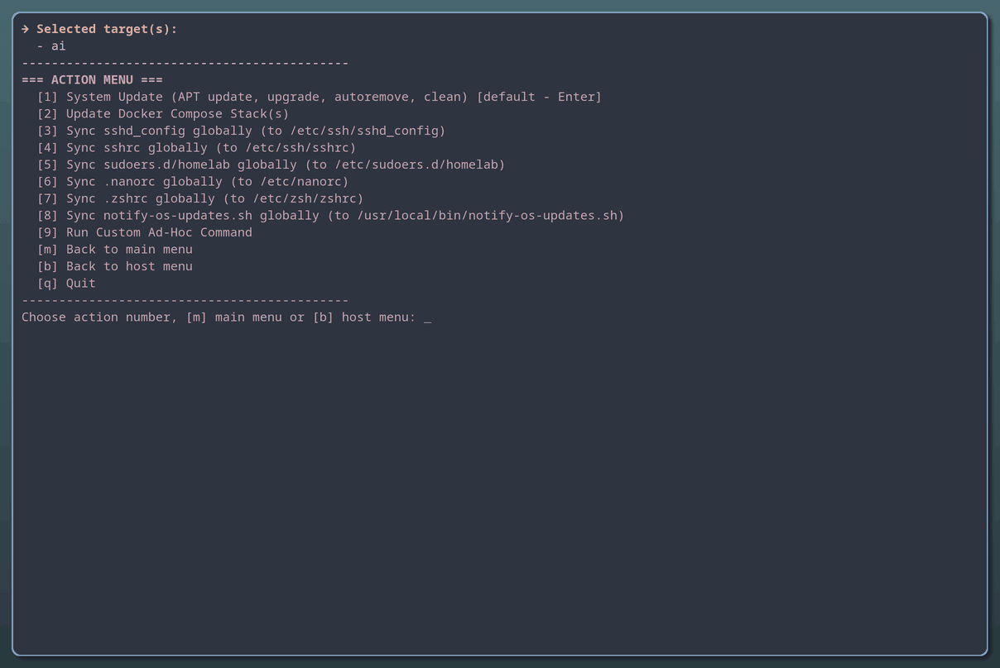

# homelab-ssh

A menu over SSH for a small homelab: pick servers by tags in `~/.ssh/config`, then update their packages,
update their Docker Compose stacks, copy config files to them or run one command on all of them. Plain Bash.



## Why

For a handful of servers and a few routine jobs, Ansible is a lot to learn: inventories, playbooks, modules, YAML.
This is one menu instead: choose a tag, choose hosts, choose an action. Every action is a short Bash script
you can read in a few minutes and change.

## What it does

| Action | On every chosen host |
|---|---|
| System update | `apt update`, `dist-upgrade`, `autoremove`, `clean` (Debian, Ubuntu, Proxmox) |
| Update Docker Compose stack(s) | lists the stacks in `/srv/docker-compose`, pulls and restarts the ones you pick, offers `docker image prune` |
| Sync sshd_config, sshrc, sudoers, nanorc, zshrc, notify-os-updates.sh | copies the file from your own repo to the host; sudoers is checked with `visudo` first |
| Run a custom command | one command you type, e.g. `uptime` or `df -h` |

Hosts are done one after another. A host that doesn't answer can be retried (after you start it) or skipped.
Every menu has `[b]` back and `[q]` quit, Enter takes the default.

## You need

- On your computer: `bash`, `ssh`, `curl`, and `jq` for the zshrc sync.
- Servers in `~/.ssh/config` that you reach with an SSH key, without a password prompt, and `sudo` on them.
- Docker Compose on the servers for the Docker action.

## Install

```bash
git clone https://github.com/archlinux-fan/homelab-ssh ~/homelab-ssh
mkdir -p ~/.local/bin && ln -s ~/homelab-ssh/homelab ~/.local/bin/homelab
mkdir -p ~/.config/homelab && cp ~/homelab-ssh/config.example ~/.config/homelab/config
nano ~/.config/homelab/config        # where your files come from, see below
homelab
```

`~/.local/bin` is in the `PATH` on most systems; if `homelab` isn't found, start it as `~/homelab-ssh/homelab`.

## Tag your hosts

homelab reads the hosts and their tags from your `~/.ssh/config`. A tag is a comment line under a host:

```
Host web1
    HostName 192.0.2.10
    User admin
    # TAGS: Debian, Docker
```

The main menu lists every tag; picking one lists its hosts. The rules, and how to set up key login:
[docs/ssh-config.md](docs/ssh-config.md).

## The files it copies

The "Sync" actions take the files from a repo of yours, best a private one, where each file sits under its
path on the server. `SYNC_BASE` in `~/.config/homelab/config` is its raw-file address, or for a private
repo the path of your local clone (`file:///home/you/homelab`), so no login is needed:

```
your-repo/
├── etc/nanorc
├── etc/ssh/sshd_config
├── etc/ssh/sshrc
├── etc/sudoers.d/homelab
└── usr/local/bin/notify-os-updates.sh
```

- nanorc is written without a password; the host needs a sudoers rule for it, e.g.
  `you ALL=(root) NOPASSWD: /usr/bin/tee /etc/nanorc`.
  All the others ask for your sudo password on purpose: they run at every login, control SSH or grant root.
- The zshrc is joined from a folder of zsh parts (`ZSH_PARTS_API`); the parts of
  [arch-dots](https://github.com/archlinux-fan/arch-dots/tree/main/.config/zsh/conf.d) work as they are.
- Don't need an action? Delete its line from `ACTIONS` in `homelab`.

## Add an action

The `ACTIONS` list near the end of `homelab` has one `"Label|script.sh"` line per menu entry, in menu order.
A script in `homelab-actions/` gets the chosen hosts in `$TARGET_HOSTS`; `libs/lib_check_host.sh` has the
helpers (`check_host_alive`, `confirm_next`) and the exit codes that send you back to a menu.

## Pictures

Made with a demo setup: the real scripts and menus, the servers' answers are made up.

| | |
|---|---|
|  |  |
| Main menu: the tags from `~/.ssh/config` | Hosts with the tag Debian |
|  |  |
| Actions for the chosen host | Docker: the stacks found on the host |
|  |  |
| One stack updated, old images pruned | System update |
|  |  |
| `uptime` on three hosts | A host that is off: wait, then retry or skip |

The desktop in the pictures, with mango, waybar, foot and the Nord colours, is
[arch-dots](https://github.com/archlinux-fan/arch-dots).

## License

[MIT](LICENSE): use, change and share it as you like; keep the copyright notice.
